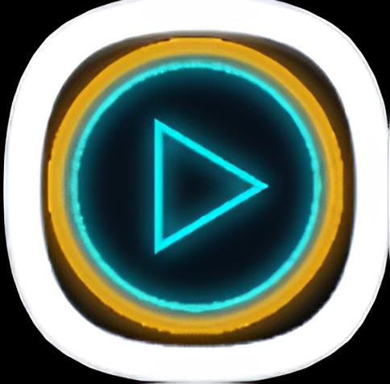

  

  # MinimalPlayback
  **A clean, lightweight, distraction-free music player built by Astrix Studios.**

  

    
    
  

---

### 📱 App Previews

  <table>
    <tr>
      <td align="center"><strong>Android</strong></td>
      <td align="center"><strong>iOS / Concept</strong></td>
    </tr>
    <tr>
      <td></td>
      <td></td>
    </tr>
  </table>

---

### ✨ Features
* **Zero Bloat:** Instant startup and smooth playback without unnecessary clutter.
* **Signed Production Build:** Officially signed by **Asterix.GG (Astrix Studios)** for clean installation on Android 11+.
* **Minimalist UI:** Focused purely on your audio controls and library.

---

### 📥 How to Install
1. Click the **Download Latest Release** button above.
2. Under **Assets**, download **`app-release.apk`** (or the `x64` variant if listed).
3. Tap the downloaded APK on your phone, allow installation from your browser/file manager if prompted, and tap **Install**.
